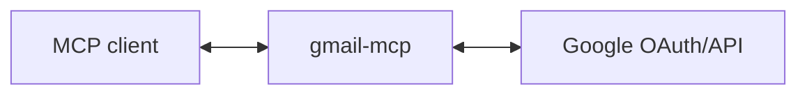

# gmail-mcp

MCP server for Gmail - read, send, archive, and manage emails.

## Use Cases

**Flight check-in**: "Check me in for my flight tomorrow" → finds your confirmation email, extracts the booking reference, and completes check-in with browser use.

**Expense submission**: "Submit my Amazon purchases from last week as expenses" → finds receipts, extracts amounts/categories, and files them in your expense system.

**Package tracking**: "Where's my package from Acme?" → finds the shipping notification, extracts the tracking number, and fetches current delivery status.

**Find that attachment**: "What did we settle on for the budget? Michelle sent me something yesterday" → locates the email and opens the attached spreadsheet.

**Vacation mode**: "I'm on holiday Dec 20-Jan 2" → sets up Gmail auto-reply, blocks your calendar, and updates your Slack status in one go.

**Meeting follow-up**: After a call, your assistant reads the Gemini transcript, summarizes key decisions, and drafts a follow-up email with action items.

(These are just examples - any workflow that needs email search, reading, or sending can use this.)

## Setup

### 1. Create Google OAuth credentials

1. Go to [Google Cloud Console](https://console.cloud.google.com/)
2. Create a new project (or use existing)
3. Enable the Gmail API
4. Go to **APIs & Services** → **OAuth consent screen**, set up consent screen
5. Go to **APIs & Services** → **Credentials** → **Create Credentials** → **OAuth client ID**
6. Choose **Web application**
7. Add `http://localhost:3000/callback` to **Authorized redirect URIs**
8. Note your Client ID and Client Secret

### 2. Run the server

```bash
GOOGLE_CLIENT_ID='your-client-id' \
GOOGLE_CLIENT_SECRET='your-client-secret' \
MCP_TRANSPORT=http \
npm start
```

The HTTP listener binds only to `127.0.0.1`. The default advertised URL is `http://localhost:3000`. Change the port with `PORT=3001`.

The server defaults to read-only mode on both transports. It exposes 13 read tools and requests only `gmail.readonly`.
Add the single `--destructive` flag to enable all 36 tools, including sending, forwarding, draft changes, and deletion:

```bash
npm start -- --destructive
npm run start:http -- --destructive
node dist/main.js --destructive
```

The flag does not change existing token permissions. Disabled tools remain unavailable even when the token allows writes.
Use `MCP_BASE_URL` to advertise an HTTPS reverse proxy. The listener still binds only to loopback.

### 3. Add to your MCP client

With the server running, follow the instructions on [install-mcp](https://adamjones.me/install-mcp/?url=http://localhost:3000/mcp), which generates the right config for your MCP client (Claude Code, Claude Desktop, Cursor, Cline, VS Code, and more).

## Architecture

This server acts as an **OAuth proxy** to Google:



1. The server advertises OAuth metadata at `/.well-known/oauth-authorization-server`.
2. `/register` creates a public client with exact registered callback URLs. It does not expose Google credentials.
3. `/authorize` requires S256 Proof Key for Code Exchange (PKCE) and creates an opaque, browser-bound transaction.
4. `/callback` checks that transaction and issues a one-use local code to the registered callback.
5. `/token` checks the client, callback, and verifier before it exchanges the stored Google code.
6. `/mcp` uses the bearer token to call the Gmail API.

Callback URLs must use HTTPS or loopback HTTP (`localhost`, `127.0.0.1`, or `[::1]`).
Registrations and pending transactions remain in memory. A restart requires registration and authorization again.
Authorization transactions and local codes expire after ten minutes. The client keeps the Google access and refresh tokens.

## Tools

| Tool | Description |
|------|-------------|
| `get_profile` | Get the account email address and profile |
| **Messages** | |
| `messages_list` | Search or list messages |
| `message_get` | Get a message |
| `message_send` | Send an email |
| `message_forward` | Forward an email |
| `message_modify` | Add or remove labels |
| `message_archive` | Remove a message from the inbox |
| `message_trash` | Move a message to trash |
| `message_untrash` | Restore a message from trash |
| `message_delete` | Permanently delete a message |
| `messages_batch_modify` | Change labels on multiple messages |
| `messages_batch_delete` | Permanently delete multiple messages |
| **Threads** | |
| `threads_list` | Search or list threads |
| `thread_get` | Get all messages in a thread |
| `thread_modify` | Add or remove labels |
| `thread_trash` | Move a thread to trash |
| `thread_untrash` | Restore a thread from trash |
| `thread_delete` | Permanently delete a thread |
| **Drafts** | |
| `drafts_list` | List drafts |
| `draft_get` | Get a draft |
| `draft_create` | Create a draft |
| `draft_update` | Change a draft |
| `draft_send` | Send a draft |
| `draft_delete` | Delete a draft |
| **Labels** | |
| `labels_list` | List labels |
| `label_get` | Get a label |
| `label_create` | Create a label |
| `label_update` | Change a label |
| `label_delete` | Delete a label |
| **Attachments** | |
| `attachment_get` | Download an attachment |
| **Filters** | |
| `filters_list` | List filters |
| `filter_get` | Get a filter |
| `filter_create` | Create a filter |
| `filter_delete` | Delete a filter |
| **Settings** | |
| `vacation_get` | Get vacation settings |
| `vacation_set` | Change vacation settings |

Harnesses add tool prefixes. This server does not add them.

## Gmail API Scopes

- Default: `gmail.readonly` for read tools.
- With `--destructive`: `gmail.readonly`, `gmail.send`, and `gmail.modify`.

## Contributing

Pull requests are welcomed on GitHub! To get started:

1. Install Git and Node.js
2. Clone the repository
3. Install dependencies with `npm install`
4. Run `npm run test` to run tests
5. Build with `npm run build`

## Releases

Versions follow the [semantic versioning spec](https://semver.org/).

To release:

1. Use `npm version <major | minor | patch>` to bump the version
2. Run `git push --follow-tags` to push with tags
3. Wait for GitHub Actions to publish to the NPM registry.
